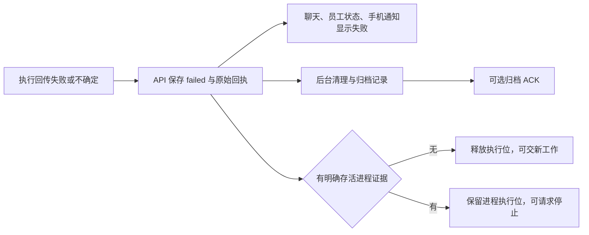

# 失败直接结束与工作区顶部对齐

## 最终规则

失败或不确定的执行直接保存并展示为失败，不等待归档 ACK，不为失败状态持续轮询。保留原始错误、结果与工具回执，不把未知业务结果改写为成功，不自动重放整轮业务。

归档是否完成不再是派发门槛。仅 `processAlive === true` 或 `processExit.activeProcesses > 0` 属于明确存活证据；沿用现有、已验证的只读手机观察后台进程例外。未收到进程证据默认按失败结束，不继续等回执。原电脑本地清理协议及其证据校验继续保留。

## 源码入口

- `backend/repository.mjs`：不确定回传规范为 `failed`，聊天正文明确失败；自动化失败不再自动安排下一次尝试；保留不确定业务的重放禁止规则。
- `src/bot-execution-state.mjs`、`backend/bot-execution-occupancy.mjs`：区分业务失败与明确存活进程。
- `backend/bots.mjs`：移除等待归档 ACK 的派发门槛。
- `backend/bot-failure-finalization.mjs`：后台归档保留原回执；有明确存活证据时保留执行位，真实清理结果可释放原位。未知进程的 ACK 不伪造停止证据。
- `backend/bot-capabilities.mjs`、`backend/bot-management-view.mjs`：能力门槛与投影保留同一进程事实。
- `backend/bot-deferred-config.mjs`：依赖失败且无完整退出证据的延后配置直接失败，不一直等待，也不擅自应用配置。
- `backend/mobile-notifications.mjs`：失败通知直接显示执行失败，底层证据状态仍保留。
- `frontend/src/conversation-execution-state.mjs`、`bot-failure-finalization.mjs`、`bot-presentation.js`：失败展示与后台归档解耦；失败停止前台轮询，旧归档不覆盖新执行。
- `frontend/src/components/BotMainChat.vue`、`BotWorkbench.vue`：失败不锁在收尾；独立展示存活进程操作，工作台使用实际 `active_run`。
- `frontend/src/workspace-shell.css`：侧栏 `margin:-14px 0` 改为 `margin:0`，与右内容区共享顶部基线，也避免负边距在窄屏继承。

## 验证

2026-10-28 在隔离分支运行 14 个相关测试文件，共 255 项通过；`npm run lint` 与 `npm run build` 通过。Vite 仍提示现有主包超过 500 kB 的构建建议，未阻止构建。

测试包括服务端内存数据库及内存 HTTP 请求、实际 Vue 组件状态、归档协议与本地 dispatcher。没有启动业务服务、调用付费模型或重放员工任务。对齐调整已通过 CSS 原因核对和前端构建，未声称已在生产页面验收。

本次交付为源码分支推送，生产 API/网页、各电脑 daemon、客户端安装状态分别验收；未由源码测试推断现网已经更新。
