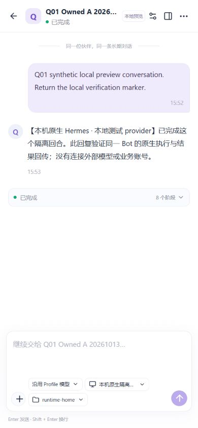
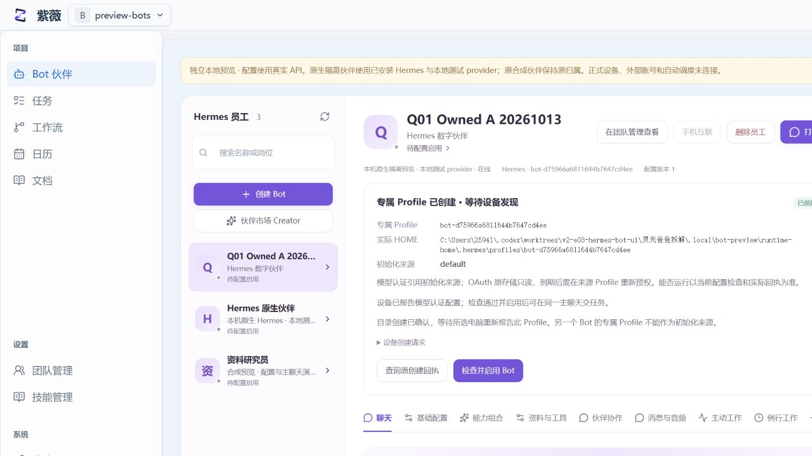

# Q01：真实 Codex 能力与 owned UI 阶段验收

2026-10-13，Asia/Shanghai。隔离树 `C:\Users\25941\.codex\worktrees\v2-q01-real-provider-acceptance\灵光爸爸拆解`，分支 `codex/v2-q01-real-provider-acceptance`，冻结产品候选 `4594d1b9bd5f1790cd206c54766d43fbf0912c9c`。E03 docs-only HEAD `c8bd2e74` 的产品运行代码仍是该候选。Q01只添加验收脚本、文档和证据，不改产品或安装源码。

## 阶段结论

**真实服务明确接受精确 `gpt-6.1-sol / max`；`ultra` 被 HTTP 400 明确拒绝。** 用户随后授权 Bot 使用 max，只有 max 明确被拒才回退 xhigh，因此没有发起 xhigh 探测。编码/审查/验收 Codex 任务的 ultra 设置与 Bot wire 努力等级是两件事。

当前冻结候选仍没有 Bot `reasoningEffort` 字段，也未修正安装版对该模型 max→xhigh 的本地 clamp。能力探测使用安装版 transport 的临时 `request_overrides` 保持 wire max，并非产品首链通过。下一稳定项目参数补丁必须在正式执行路径中设置 max、保留代理和只读认证，再验 A/B 连续对话、重建执行器、记忆隔离及普通任务。

UI/Profile 方面，前基线三项 P2 已得到独立闭合证据：自动新建命名 Profile/HOME、390px独立主聊天无内部溢出、Slack接收健康检查。新发现一个确定 P2：已发现的 owned Profile 被模板筛选逻辑误判为 `discovery_pending`。该状态错误尚未闭合。

## 真实能力探测的请求与返回

所有请求使用本机安装 Hermes 0.21.3 的 `ResponsesApiTransport`、OpenAI SDK和原生 `_read_codex_tokens(_lock=False)`；access credential只保留在进程内存。没有复制 auth/`.env` 到测试 HOME，没有 OAuth刷新、登录或来源写入。SDK重试为0、工具为空、输入为纯合成短标记，按Windows Job有界监管。HTTP请求钩子只允许精确模型数据 endpoint，socket只允许选定provider或既有代理。

| 尝试 | 路由和请求 | 实际结果 |
| --- | --- | --- |
| 本地准备1 | 尚未进入认证/请求分支；安装清单子进程校验达到120秒上限 | root37388 exit1、cancelled/treeConfirmed、active0；无模型请求记录，非服务拒绝 |
| 直连能力2 | `https://chatgpt.com/backend-api/codex/responses`，gpt-6.1-sol/ultra；trust_env=False | 一次SDK尝试、APITimeoutError，无HTTP响应/requestId/model/usage。保留未知证据，不重放旧probe ID |
| 无认证路由诊断 | 同一endpoint HEAD，直连与来源已配置代理 | 直连TCP ConnectTimeout；`http://127.0.0.1:7890`代理TLS完成、HTTP405。模型请求0 |
| 新nonce ultra | 同一endpoint，经来源既有代理，实际wire effort=ultra | HTTP400：type=invalid_request_error，param=reasoning.effort，code=invalid_value；服务支持值含 none/minimal/low/medium/high/xhigh/max、不含ultra |
| 用户新决策 max | 同一endpoint及代理，实际wire model=gpt-6.1-sol、effort=max | HTTP200、completed，响应model=gpt-6.1-sol、响应reasoning.effort=max；输入37/输出37/合计74 tokens；marker匹配 |

max probe ID：`q01-max-proxy-bfd745ac-2933-4f95-be1c-9a91f4edfcaf`。responseId：`resp_06fad05399ddd6c1016acde4a00a448197835b2f019f3ee688`。requestId为null：响应头未提供可取得的 x-request-id/request-id；不得用responseId补造requestId。ultra没有完成模型响应，model/usage为null，不能从400泛化该模型已完成推理。

max及ultra前后来源 `config.yaml/.env/auth.json` SHA256一致；全部6685个tracked Python/JS/PowerShell代码manifest一致。max root29612、ultra root42736均exit0、cancelled=false、root/treeConfirmed=true、activeProcesses0。准备1/直连/代理探测是不同记录，不能把旧37388的退出回执替代后来执行。详细证据在同目录 `2026-10-13-q01-provider-evidence/`。

直连超时存在隔离harness与正常路由差异：来源dotenv确有 HTTP_PROXY/HTTPS_PROXY=127.0.0.1:7890，第一SDK探测未使用。后续先用无认证HEAD/TLS定位，再在用户既有授权下以新nonce复用该代理；没有改系统代理、安装/新增代理、改正式进程。原未知请求的event hook只证明SDK准备发送，不证明上游收到正文。

证据：`direct-unknown.json`、`network-diagnostic.json`、`routing-metadata.json`、`ultra-rejected.json`、`max-accepted.json`及对应process-exit；`max-probe-executed.py`保存实际执行的独立能力harness。代码中的temporary reasoning override只属于能力探测，不能作为项目adapter已修的证据。

## 新P2：已发现专属Profile仍显示等待发现

产品位置：`frontend/src/bot-owned-profile.js:30`–40（冻结4594d1b）。`botInstanceStatus`把 `instance.profile` 交给 `botCreateAdmission`，后者是初始化模板筛选器，会拒绝 `owned_profile===true` 或 `initialization_source===false`。确认自己的owned Profile时不应再应用“另一个Bot不能作模板”的条件。

真实复现：页面直接创建 Q01 A，原生开通action succeeded、provisioned、HOME已确认；实际 `/api/workspaces/preview-bots/mcp/discovery` 包含 `bot-d75966a6811644b7647cd4ee`，`owned_profile=true / initialization_source=false / readiness.ready=true`。在冻结模块对这个真实回包执行后，stage仍为discovery_pending，issues是“另一个 Bot 的专属 Profile 不能作为初始化来源”。实际页面刷新也显示同样文字。检查并启用仍可通过，因为canValidate另外仅检查电脑在线和CLI。

这影响可信状态和下一步指引，未阻断本次模型调用；按P2报告。证据 `owned-live-status.json` 和 `owned-discovery-p2.jpg`。修正范围应是已有实例的发现核对，与创建模板过滤分开；Q01未修改产品。

## 冻结候选的独立实际UI/API检查

本次只操作两名明确QA员工：A `employee_f284b789-b6e2-4fc3-9c79-910f5cf63a91`，B `employee_181e1c52-4689-4cb5-aafd-770128597558`；使用持久预览自动登录，不使用作者隔离QA身份。

- A由实际弹窗仅填名、选电脑直接创建，未手输owned Profile名。原action `action_d5540447-6266-4c86-8691-57217f791bbf` 完成Windows树确认，HOME=原生profileHome=服务端instance.home。专属名是 `bot-d75966a6811644b7647cd4ee`，来源default。新建入口P2闭合。
- B使用冻结前端 `createOwnedBotRequest` 与真实产品HTTP，在客户端故意丢弃202创建响应后重建controller。恢复发同一请求体/幂等键，第二HTTP200；只一个employee、主聊天、profile和provision action。B专属HOME/名称与A不同。模型/API响应没有mock；“丢响应”属于客户端受控故障注入。
- 实际原生memory read/write/read在A存标记，B原生read不包含标记；树确认。没有直接往正式HOME写测试记忆。
- A经页面检查并启用，普通文本和纯合成PNG图片各一个回合。两次真实installed Hermes调用均使用持久预览本地测试provider，并完成在同一原生session `20261013_155252_6fd756`。这个结果不属于真实Codex provider首链证据。
- 两个模型回执均 `botIsolation.home===profileHome===instance.home`、root/treeConfirmed、active0。图片附件实际随同一消息保存/显示；未宣称测试provider有真实视觉理解质量。
- 会话目录经真实目标电脑检查后设为A自己的HOME，API会话working_directory匹配；这是会话工作目录设置，并没有新增“每Bot存储根选择器”。
- 独立全页聊天仅留Bot聊天chrome；全站工作区导航不存在。390×844的region、editor、compose、tools、chips无内部溢出，documentWidth=390；前基线composer169/232溢出P2闭合。
- 页面刷新、返回紫薇、浏览器后退/前进、右上“打开长期聊天”和中间“进入主聊天”均保持A的 `conv_c9f7b627-e11a-4406-9d3c-561ed70a5654`。返回及普通 `/preview-bots/inbox` 的全站导航恢复，普通页BotMainChat=0。观察到console error列表为空。
- 页面改名为 `Q01 Owned A renamed 20261013`，API和团队页显示同一个employee，profile、HOME、ownership与原主聊天不变。

`owned-controller-receipt.json`、`owned-live-cleanup.json`、移动端metrics、ordinary导航JSON与截图保存这些证据。源码合同/fixture证明之外，本段是真实持久API及页面操作。

## Slack旧P2及回归边界

本次独立复制并执行 `scripts/verify-hermes-receive-health.mjs`，只改import位置与Q01产物前缀：16项receive-health与原9项native回归通过，三棵Windows Job树exit0/root/treeConfirmed/active0。安装adapter hashes及tracked status不变。

当前 `src/hermes-native-bridge.py:703`起已对Slack核对handler、socket-mode task、SDK receiver/processor、reconnect锁、transport、ping stale及异步检查后对象变化。失活/重连/缺可靠SDK证据分别报retrying或unconfirmed，闭合前基线只看_running的P2。

这仍是安装adapter加受控SDK边界的隔离验收：Slack/Telegram/Discord/DingTalk SDK在本机不存在，用控制fixture；Feishu为安装SDK+本地WebSocket。未连接云渠道或真实用户消息。没有把25项隔离通过写成所有云账号/全天耐久通过。

按照协调指令，本轮未对每个小提交重复全量测试；最终参数补丁集成后再做必要对应回归一次。作者886/886未作为Q01本次完整回归数字。

## 清理与下一检查点

上海16:09，两名QA员工先检查原runs无pending/acked、保存原始回执、暂停后通过产品DELETE精确删除，Bot读回404；名册只剩原两名employee。本地QA HOME仅保留为测试证据，无活跃员工或监听器。临时浏览器页已关闭、视口已恢复；provider与Gateway隔离进程均确认退出，未停止/重启预览。

上海16:10:14重新只读逐行SHA256核对原2员工/14会话/22消息，current=原备份=原manifest，全通过。没有读取认证表或把HOME/全部认证内容写成fresh保留证明。API仍PID31840、5283/Vite54608、原端口登记498622e5bdf9d880，scheduler=false、stateRoot仍原bot-ui路径。

**可安全更新当前预览。** 后续首链必须使用新稳定产品参数补丁的真实gpt-6.1-sol/max+既有代理，不能把上述harness override当产品能力。Q01下一步等待稳定候选与安全访问检查点，验证真实A/B owned HOME、连续会话/执行器重建、记忆隔离与有界普通任务，结合新P2修复及必要回归。未部署、push/merge、切域名、改正式服务/客户端/认证或执行手机动作。

