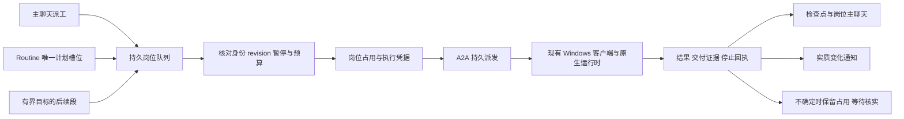

# V2：24 小时岗位数字员工设计

日期：2026-10-12（Asia/Shanghai）。状态：**方案中；文档已形成供审查，产品未实现、未实测、未发布**。本文的字段、接口、默认值与验收阈值是提案，不代表当前产品能力。

用户目标：“我就想做一个24小时的数字员工”；岗位描述目前仅“也算是一个岗位吧”。用户随后选择“先在现有电脑持续开机时全天工作”。首个业务岗位、职责和业务数据尚未给出，本方案只定义可配置岗位机制，示例只用于隔离验收。本文不授权创建正式员工或执行业务。

关联：[实施计划](../../plans/2026-10-12-24h-role-employee.md)、[验收设计](../../plans/2026-10-12-24h-role-employee-acceptance.md)、[V2 会话台账](../../handoffs/V2_SESSION_LEDGER.md)。

## 1. 目标与完成定义

“24 小时”指岗位控制与调度在宿主可用时持续值守：用户消息、保存的计划或允许的内部事件唤醒员工；有工作才执行，无工作安静等待。每次模型执行有截止时间，同一员工串行，不以模型不停思考、永久 CLI 会话或删除 15 分钟超时来实现全天值守。

首版用户能保存一个岗位的身份、长期职责、禁区、交付物标准、主聊天和例行计划；看到下一次计划、当前执行、等待原因与最近成果；从主聊天派工；暂停岗位、停止单次工作和恢复；在中断后看到真实状态与受控恢复结果。后台服务在线与员工正在工作分开显示。

首版完成必须同时满足：岗位/计划/执行/结果持久化，可信绑定，独立记忆，唯一执行权，同员工串行，有界目标推进，停止确认，离线/重启恢复，汇报不扰民，以及独立 Q 验收的真实连续 24 小时隔离运行。短时加速夹具通过只能说明调度逻辑通过；代码、真实运行、上线是三个独立状态。

## 2. 可选路线及推荐

| 路线 | 做法 | 收益 | 代价与风险 | 结论 |
| --- | --- | --- | --- | --- |
| A：紫薇统一调度与岗位台账，原生 CLI 执行 | 在现有 SQLite/自动化/A2A 链路上增加岗位运行层；Hermes 每次运行有界，平台维护主聊天和检查点 | 用户可在现有网页看清任务归属、暂停和恢复；复用已验证的 A2A 与 Windows 监督 | 需要补持久任务队列、岗位记忆和取消控制；不能只给旧 automation 增加 employeeId | **推荐首版** |
| B：Hermes Gateway/cron/goals/heartbeat 为主 | 独立 Hermes HOME 运行原生 Gateway，由紫薇管理/镜像其状态 | 原生功能集较完整，后续可减少重复实现 | 本机版本与官网不一致；Gateway 未在本链路接入，双调度和控制权同步复杂，需要额外驻留进程与运维验证 | 后续评估；本轮不启动 Gateway，不升级 Hermes |
| C：独立常在线宿主 | 把方案 A 的执行环境迁往常在线 Windows 或适配后的服务器 | 可降低个人电脑休眠/断电影响 | 工具、文件、账号、设备访问边界需要重新确定；服务器不能天然执行离线电脑上的工作 | 用户已选择现有电脑，C 不属于首版 |

路线 A 的首个原生运行时建议收窄为 **Windows + Hermes + 已验证的 openai-codex 认证路径 + 本地记忆**，平台队列接口保留 runtime 字段。当前其他 CLI 的既有功能继续保持，但不将其列为新的 24 小时岗位已支持组合。首个正式岗位若依赖该组合不支持的工具，应重新评估最小运行时范围，不默认升级或扩到所有 provider。

## 3. 现有证据与需要补齐的边界

源码基线 `2ebe3dfee2f438a0b6aa3045d46c83bb67d7341b`；V1 封版 `c2e360a3af12eda2152023876cee16cfaf29a949`、产品修复 `324731e79c6a855fad1f501379630bbfa67e5d34`。2026-10-12 本次只读 `git ls-remote origin refs/heads/codex/employee-default-workdir` 返回与基线相同 SHA，不能据此声称部署了新版本。

| 已核实位置（行号属于上述基线） | 当前能力 | V2 需要补齐 |
| --- | --- | --- |
| `backend/repository.mjs:337`、`:346` | 可信 Creator 主动附带最多 16 条 / 12,000 字符历史 | 普通岗位主聊天的执行时上下文、摘要检查点和证据引用；平台保存消息不等于模型记得消息 |
| `backend/repository.mjs:360`、`:365` | 职责/人格/指令和技能内容进入 prompt，选择 employee/runtime/model/profile/device | 岗位统一的可信快照与 revision；不能把技能市场挂载称为原生 SKILL.md 安装或学习同步 |
| `src/local-action.mjs:425`、`src/creator-runtime-home.mjs:58` | Creator 独立持久 HOME；普通员工可使用原生 profile | 普通岗位按员工隔离；同 profile 不等于不同员工的记忆隔离；既有用户 HOME 不自动搬迁 |
| `src/runtime-adapters.mjs:385` | Hermes 通过 `-z` / `chat -q` 运行 | 当前链路没有已接入 ACP/session 恢复的证据；首版平台持久上下文不依赖声称已恢复原生 session |
| `backend/repository.mjs:152`、`:979`、`:1014`；`backend/app.mjs:375` | 中文计划/五段 cron/timezone/next_run、执行记录、重试、通知、HMAC 出站 Webhook；单进程约 15 秒 tick | 已有自动化需复用；runAutomation 当前 payload 未绑定岗位/模型/profile/设备/主聊天，缺唯一计划槽位、持久占用和岗位恢复语义 |
| `backend/repository.mjs:1050`、`:1056`、`:1948` | automation 失败进入重试路径 | 岗位不可把所有 failed 当可重试；不确定执行必须隔离，不能从通用失败路径盲目生成新 action；新岗位路径须独立映射结果 |
| `src/daemon-action-scheduler.mjs:4` | 内存中按员工串行、默认有限并发 3、上限 8，并为父/子执行留容量 | 保留本机限制，补服务端持久占用；不将内存锁当作跨重启唯一执行权 |
| `src/daemon.mjs:198`、`:392`；`src/daemon-action-delivery.mjs:131` | cancel 请求回执明确 stopConfirmed=false；持久落盘、结果补传、EXECUTION_UNCERTAIN 与 Windows Job 监督 | 岗位/网页控制尚需接入；控制通道不能被被取消任务占满的执行队列阻塞 |

V1 的 709 项测试、已安装 build、历史真实 nonce 属于 V1 证据，本轮没有运行这些测试或模型。ThinkPad 只存在用户提供的 54a053…升级 complete；其在线状态与 7e2…版本未核实。

### 官方文档、本机安装与产品接入的区别

2026-10-12 按 web-access 技能只读查询下列一手资料；未启动浏览器代理或 Gateway。官方页面是当前官网陈述，不是本机安装或紫薇产品验收：

| 官方页面 | 对方案有用的已核实内容 | 不应外推的结论 |
| --- | --- | --- |
| [Bot Mode](https://hermes-agent.nousresearch.com/docs/user-guide/bot-mode) | profile 身份、主聊天、归属 Bot 的 Routine，以及区分真正活动与仅连接 | 紫薇未因此自动获得 Bot Mode；隐藏不等于暂停 |
| [Memory](https://hermes-agent.nousresearch.com/docs/user-guide/features/memory) | 有限长期记忆在会话开始读取快照，官方要求不同 agent 不共用 HOME | 主聊天持久不等于当前上下文或记忆快照实时更新 |
| [Cron](https://hermes-agent.nousresearch.com/docs/user-guide/features/cron) | 原生计划台账、unknown 不自动重跑、离线合并和暂停不补跑；不保证业务副作用恰好一次 | 原生锁不是平台与 Hermes 的统一锁；官网 systemd 特性不能直接当 Windows 能力 |
| [Goals](https://hermes-agent.nousresearch.com/docs/user-guide/features/goals) | 单会话持续目标、有限轮次和完成契约；暂停续作不等于中断当前轮 | Goals 不能单独承担全天值守；官方 ACP 也未实现 /goal |
| [Heartbeat](https://hermes-agent.nousresearch.com/docs/user-guide/features/heartbeat) | 空闲时触发、人工输入优先、错过合并和无变化静默；仍依赖所属进程 | 静默输出仍可能产生模型调用；触发数不等于执行或交付数 |

本机静态只读证据：可见 `hermes.exe` 位于 `C:\Users\25941\AppData\Local\hermes\bin\hermes.exe`，启动器指向同安装树 venv；`hermes-agent\venv\Lib\site-packages\hermes_agent-0.21.3.dist-info\METADATA` 第2–3行显示 `hermes-agent 0.21.3`，editable finder 绑定 `C:\Users\25941\AppData\Local\hermes\hermes-agent`，源码 `pyproject.toml:5` 与 `hermes_cli/__init__.py:6` 一致。该源码 HEAD 为 `bbaf7af5c83546d19f8060f4097d3bb25cd1a3c3`，存在用户已有锁文件/网站文档修改，本轮保留。

本机 `hermes_cli/main.py:1423` 有明确 session 恢复入口；`acp_adapter/server.py:588` 有会话接口，`:603` 的 resume 在会话不存在时会新建，未来适配必须识别而不能冒报恢复。`hermes_cli/heartbeat.py:1` 是进程内会话心跳，`hermes_cli/cron.py:42` 的内置 ticker 依赖 Gateway，`hermes_cli/goals.py:1` 有 turn budget。以上仅是静态源码存在；当前 Gateway 是否在线、认证/模型是否可用、与紫薇 bootstrap 的运行兼容性均 **unknown / 未运行验证**。本机版本核实不代表官网所有最新语义均存在。

## 4. 岗位对象、可信身份和状态

岗位是现有 employee 的可选长期运行配置，不自动将所有员工升级为全天岗位。提议新增 `employee_roles`（名字是实现建议），一名 employee 最多一条岗位控制记录。

| 对象 | 提议持久数据 | 关键约束 |
| --- | --- | --- |
| 岗位 | workspace_id、owner_user_id、employee_id、role_revision、职责/禁区/交付标准、main_conversation_id、control_state、control_epoch、timezone、预算 | 服务器从当前身份、employee 和成员权限推导归属；请求不能自报可信 owner；新岗位默认 draft，确认职责后显式启用 |
| 运行绑定 | device_id、runtime、model_id、source_profile、binding_revision、verified capability/build、memory_namespace | 员工/会话/设备必须同一可信归属；更换设备/profile 需要明确迁移方案；不能静默选择另一台在线设备 |
| Routine | routine_id、employee_id、revision、schedule、timezone、anchor、next_due_at、missed_policy、max_lateness、authority、enabled | 保存前验证 IANA 时区并预览未来 3 次；authority 首版只允许 platform；不在 Hermes cron 建同一意图 |
| 岗位工作项 | work_id、source_type/source_id、intent_key、role/binding/routine_revision、priority、not_before、expires_at、checkpoint、预算余量 | 人工、计划、目标后续段进入同一队列；每个意图唯一；普通聊天不因队列存在而自动增加任务看板卡片 |
| 执行与占用 | run_id、attempt、action_id、employee_id、device_id、executor_epoch、fencing_token、lease_until、state、stop_requested_at、stop_confirmed_at | 一员工最多一个占用；不确定占用保留；租约过期本身不能证明旧执行已停止 |
| 结果与汇报 | result_id、artifact refs/hash、completion_check、usage、cost、notification_key、conversation_message_id | 结果原子记录且幂等回写主聊天；缺数据为 null/unknown；不能猜价格或成功 |

采用组合状态，避免把“离线”误写成“任务失败”：

- `control_state`：draft / active / paused。暂停是持久用户意图，重启不能自动恢复。
- `availability`：online / offline / unknown，加最后心跳时间、实际设备与 build；未来时间戳不能当在线证据。
- `work_state`：idle（待命）/ queued（待执行）/ running / waiting_input / stop_requested / uncertain / failed / succeeded / cancelled。取消只有确认未启动或确认所属执行停止后才能标 cancelled。
- 页面同时显示控制状态、设备可用性和当前/最近工作结果。离线期间已有 running 且无终态时保留“离线，执行待核实”，不覆盖为已停止；无工作时显示“在线待命”，不显示“工作中”。

## 5. 唯一调度权、排队与恢复

### 5.1 计划槽位与事务

平台 scheduler 是首版唯一调度权威。Routine 与 Hermes cron/heartbeat/goals 不可同时触发同一岗位意图；原生自建计划不作为本期自动化入口。若未来从原生计划接管，先只读清单、确认原执行停止及去重映射，再转移 authority，不能双开。既有用户原生计划本轮不改。

计划键建议为 `workspace/employee/routine/revision/scheduled_at_utc`；手工键为同岗位的客户端 request_id；持续目标键为 goal_id/goal_revision/segment_no。唯一索引约束，而非仅靠先 SELECT 再 INSERT。先在短事务内写 slot、工作项及派发 outbox，并推进 next_due_at；外部网络和模型调用不进入 SQLite 事务。派发以稳定 run_id/attempt 对应稳定 A2A dedupeKey，网络重复发送只能返回原 action。

岗位人工派工与 Routine 都取得同一岗位占用。领取事务校验 active、not_before、当前 binding/revision、预算、设备新鲜在线状态和无其他占用，成功才生成一次性 start grant。客户端在 spawn 前向同一权威确认 grant/control_epoch；重复 grant、过期 epoch、错误设备拒绝。暂停和 start grant 以服务器事务顺序线性化：已确认 grant 的运行算在途，暂停必须发停止请求；暂停后不能给出新 grant。离线客户端不自行放行排队业务。已开始的有界工作可完成并落盘，联网后只补传结果。

此门槛覆盖**已启用岗位员工的所有入口**：主聊天、普通 task.execute、Creator/管理MCP派工、直接A2A以及新Routine/goal，不能仅约束新网页。服务器从可信employee记录识别岗位，客户端依据已验证的岗位绑定检查grant；旧payload缺少岗位字段也不能降级到旧无grant执行。启用岗位前该员工既有动作必须已终结或进入可解释隔离，不能边有旧工作边启用；未启用岗位的员工保持原协议。不存在可信employee绑定的动作不得用名称猜测后赋予岗位身份。

lease 用于发现失联，不允许直接抢占曾确认启动的员工。旧运行结果可按原 action/run/token 接收并回写自己的结果，不能释放新 token 的锁或推进新 revision。无法证明旧工作未开始/已结束时保持 uncertain，占用和现有设备隔离均保留。新 fencing token 只能在旧执行证据完成核实后发出；不能依赖令牌使操作系统里已运行的工具自动失效。

不确定运行须有明确的结算通路，而不是手改数据库或action-state：现有可信设备/监督器保存带 run/action/device、原fencing token、PID与创建时间、所属Job标识、停止事实和证据hash的回执；服务端只引用验证过的 evidence_id，不能接受浏览器自报 stopped=true。进入 reconciliation_pending 时继续占用，客户端幂等校验并持久解除**精确匹配**的本地隔离记录，确认后服务端事务结算同一claim。断线和重复只续办原结算，错误身份/token/hash拒绝；普通resume不能调用此流程。重启后缺乏可验证的原实例/Job证据仍保持uncertain，不用PID不存在或租约到期猜停止。确认停止但业务结果缺失时显示“已确认停止，业务结果未确认”，保留business_outcome=unknown，不改成成功、不重跑原意图；依赖其交付的后续段继续等待输入。独立的新工作只有在占用与设备隔离均已可靠解除且授权仍有效时才可启动。

### 5.2 调度语义和有界队列

首版默认 Asia/Shanghai，允许明确保存其他 IANA 时区。每天固定时刻与“每隔 24 小时”区别展示；interval 按保存的 anchor 计算，不从实际结束时间累加，避免持续漂移。夏令时缺失时刻记 skipped_dst；重复本地时刻默认只执行第一个 UTC 对应时刻，记录 offset。改变时区或计划形成新 revision，旧未派发槽位标 superseded，运行中的任务保留原快照，不能把旧完成结果当新计划完成。

建议默认 missed policy 为 `coalesce_latest`：恢复时只提交最大迟到 6 小时内最近一次遗漏槽位，较早槽位记录 skipped_coalesced；超过窗口记 missed_expired，不偷偷补一整夜。可配置 `skip` 或 `catch_up_bounded`（最多补 3 次、仍限 6 小时）；需要逐笔业务处理的岗位必须另外确定策略。暂停期间的计划默认 skipped_paused，恢复只算未来槽位，不追补暂停期间工作。

建议每岗位最多 100 个未终结工作项、每设备沿既有有限并发（建议默认 3、上限沿既有 8）。满队列对人工派工返回明确失败/可重试结果，对 Routine 留可见的 skipped_capacity；不无声丢弃。人工优先但不抢断当前执行，连续最多 3 个人工项后让一个已到期 Routine 运行，避免例行工作饥饿。相同时间按 scheduled_at、created_at、work_id 稳定排序。默认手工等待有效期 24 小时，到期明确通知，不自动执行过期请求。

恢复积压采用限速：每岗位的补跑启动间隔至少 60 秒，每设备补跑最多 3 次/分钟，且仍受岗位串行、设备并发、预算和最多 3 次 catch-up 限制；正常人工消息优先。先保存到期槽位处置，再逐批领取，不一恢复就把所有历史转成 A2A。两个 scheduler 实例即使同时扫描同一数据库，也只能通过唯一槽位索引与条件占用事务产生一个 grant；必须用两个实际独立实例竞争验证，不能只测同进程内存集合。

### 5.3 断线与失败分类

| 证据 | 处理 |
| --- | --- |
| 尚未派发，设备离线 | 持久 queued/等待设备，按有效期与 missed policy 处理，不消耗模型预算 |
| 派发响应丢失，但存在稳定 action | 查询/补传原 action；不换 intent_key、run_id 或 action_id 重做 |
| 本地已有持久结果，上报失败 | 使用现有 delivery 补传该结果/事件，CLI 调用次数不增加 |
| 明确未启动、可恢复网络/资源错误 | 按 not_before 退避，最多 2 次附加尝试；次数计预算；领取时核对计划、暂停和绑定 |
| 已启动后 provider 错误、超时或工具结果不明 | 不因“failed”盲目重试；只有交付/副作用证据证明可安全再试才建立显式新尝试；unknown 为 uncertain |
| Windows Job 或根退出无法确认、客户端执行记录损坏/丢失 | 维持 uncertain 和占用，等待证据核实；服务重启、时间经过或用户点恢复都不能自动清除 |
| 成功结果与完成检查通过 | 原子落结果/检查点/汇报，释放匹配占用；仍有待办才排下一段 |

复用 A2A 已有落盘、ACK、断线只补传与监督，不承诺任意外部副作用“恰好一次”。产品保证的是一个受控意图不会因平台重试而启动第二份未知执行；需要外部系统幂等键的业务在首个岗位定义时单独确认。

## 6. 主会话、长期记忆与数据保护

主聊天是该岗位工作的固定返回位置，run 永远保存实际主聊天 ID。更改主聊天只影响后续派发，旧结果回原会话并提供跳转。排队时保存消息 ID 与职责 revision，**真正取得执行权时**再收集已完成的前序回复与检查点，避免前一回复尚未落库导致下一问缺上下文。

上下文由固定职责/禁区、当前工作项、带来源 ID 的最近消息、版本化摘要、交付物引用组成；历史消息与网页/工具内容是引用数据，不能替代当前授权。建议初版沿用最近 16 条 / 12,000 字符作为保守上限，加受控摘要（建议最多 8,000 字符）；裁切需要记录 context_revision/source_message_ids，不能声称模型看过完整历史。只有显式受支持 runtime 才可启用 native session_id，须绑定同 employee/device/profile 并验证恢复；首版不依赖 ACP。

员工独立状态建议放在客户端受管理数据根的 `roles/<origin-hash>/<workspace-id>/<employee-id>/`，由受信任本地配置与身份派生，拒绝来自 prompt 的 HOME 路径。具体绝对路径须由后续执行者核实原生命名空间后写入运行 manifest，不能把 AppData LocalCache 当作原用户 HOME。业务 cwd 沿既有已验证默认目录继承；cwd 与记忆 HOME 分开。

复用 Creator 的隔离思想，但新增普通岗位自己的绑定标记和实现入口；不能给普通员工伪造 Creator template ID。独立 SOUL/本地 MEMORY/状态只在授权建立岗位时初始化，长期记忆有来源/时间/revision，可查看、更正与停用。平台检查点记录任务进度和交付引用，原生 MEMORY 记录运行时长期记忆，两者需标明权威范围，不混用认证库。

现有记忆迁移方案：

1. 默认保留现有员工/profile/HOME/记忆，不自动迁移、删除、搬空或改写共享 profile。
2. 正式迁移前只读确定源 namespace、绑定、文件清单和非敏感 hash；多个员工共用 profile 时不能假定其中全部记忆属于某一员工。
3. 提供可审查的迁移清单：源/目的绝对路径、归属证据、拟复制的非凭据记忆、排除认证/锁/.env/secret YAML/原生 cron、冲突规则、备份和回退。归属不明的条目留在源处，由用户决定是否选择性导入。
4. 授权后只复制选定记忆到新 namespace，源只读保留；验证不会跨岗位自动加载/注入/写入记忆、错绑定拒绝、认证仍沿受支持来源使用、新旧 hash 与跨重启读取。切换采用 binding_revision，回退仅恢复绑定引用，不覆盖整库或整个 HOME。
5. 迁移或新 namespace 核验失败时岗位保持 draft/paused，不回落到共享默认 HOME 执行。既有非岗位员工照原路径工作。

首版是应用层namespace/上下文/绑定隔离。同一Windows用户下的原生CLI具有该用户的文件权限，独立HOME本身不是操作系统安全沙箱，不能声称恶意工具在OS层绝对读不到另一目录。隔离验收检查不自动串记忆及错误绑定被拒；若岗位要求强制文件不可读，需要另行明确OS主体/ACL或容器隔离范围，不能在本期暗中增加部署或权限系统。

技能首版继续按受控快照进入 prompt，记录 skill_id/version/hash。原生 SKILL.md 安装、模型自动学习后同步回平台、任意 env/custom args 生效分别另列范围；当前持久字段不等于已在标准链注入。禁止借这些字段覆盖 HOME、身份、调度权或停止保护。

## 7. 持续目标与资源预算

长职责拆成有限工作项：目标 → 交付物/完成检查 → 当前步骤 → 本次结果/剩余工作 → 下一次唤醒。运行完成报告须含可核验文件/文档引用与内容 hash 或结构化检查；模型声称完成不足以把业务标 succeeded。需用户信息转 waiting_input，等待外部条件转 queued/not_before，完成则终结，不每分钟调用模型问“做完了吗”。

建议初始预算：单次模型执行不超过现有 15 分钟且受 ACK 剩余期限约束；目标最多 8 段；每岗位每天最多 96 次模型启动、120 分钟执行时间；最短 Routine 间隔 5 分钟。预算是提案，可在首个岗位启用前调整，不能自动变为无限。每次派发先预留剩余额度，结束按实际释放/结算；重试、摘要模型调用与目标后续段均计入。预算耗尽进入 waiting_input/budget_exhausted，发一次提醒，等待用户调整或明确的预算窗口重置。

单次实际截止还须收紧到当日剩余墙钟预算；日窗口按岗位保存的预算时区计算并持久记录，运行跨日按真实时间分摊，不能通过重启或修改时区重置已用额度。不确定运行保守保留预留，不能视为免费并发新任务。

可直接读取的 token、时长、调用次数记实际值；运行时不提供的 token/cost_usd 为 null，usage_source 写 unavailable。不能用 0 冒充免费，不能猜月费，也不能把估算金额作为已付账单。基于调用数、墙钟与有限步骤的预算在费用未知时仍有效。等待、暂停、无变化的确定性调度扫描都不发起新模型工作；暂停前已确认grant的在途集合需另列spawn/stop时序并追到收敛，不能把这一竞态伪装为立即停止。

## 8. 用户控制、汇报与运行位置

“暂停岗位”立即持久写 paused 与新 control_epoch，冻结未派发工作；对已取得 start grant/运行中的工作发送停止请求。页面应在控制请求被服务器接受后显示“已暂停接新工作，正在确认当前工作停止”，收到目标运行真实退出回执后才显示“已停止”。建议健康网络下 API 接受 2 秒内可见、在线客户端 5 秒内收到停止；30 秒仍无确认显示明确等待或 uncertain，绝不定时伪造 stopConfirmed=true。

暂停接受后新确认grant必须为0。暂停前已确认而尚未spawn的grant属于在途，可能在停止送达前出现spawn；必须记录时序并停止，确认停止后不能再spawn/续段。首版不承诺暂停请求接受的瞬间已消除所有OS线程启动竞态。

“停止这次工作”只影响指定 run；尚未启动则原子取消，已运行则通过独立控制通道到现有 dispatcher.cancel，并等待目标回执。取消通道必须能绕过已满的工作执行槽位。正常完成与停止竞态以真实终态为准，保留 stop_requested 事件，不能把先成功的结果篡改为 cancelled。设备离线时明确显示“停止请求待送达，当前工作是否停止未确认”。

“恢复岗位”只将控制状态改回 active；保留 uncertain 隔离，不重放过期任务、失败动作、暂停期间计划或旧创建消息。保留既有用户授权范围，已授权原生操作不新增每步确认流程。危险外部业务依具体授权边界判断，遇平台阻断不得用新会话或新权限路线绕过。

控制语义明确区分：

| 用户操作 | 尚未启动的工作 | 已在途的工作 | 后续行为 |
| --- | --- | --- | --- |
| 暂停员工/岗位 | 冻结所有来源的队列，新grant禁止 | 发停止请求，等待真实确认 | 显式恢复后只执行仍有效工作，uncertain继续隔离 |
| 暂停单条Routine | 此Routine未派发项记取消/跳过，暂停窗口skipped_paused | 当前运行可按原快照完成；另有“停止这次工作” | 不影响人工与其他Routine，恢复只算未来槽位 |
| 取消当前工作 | 原子取消指定work/run | 只停止指定run，等待确认 | 员工仍active，其余合法工作须等占用释放 |
| 删除员工 | 禁止全部新grant，取消未开始项，递增控制epoch | 尝试停止，保留删除墓碑、归属与在途run直到核实 | 不重建员工、不因迟到结果恢复身份；默认保留记忆/审计，不随删除自动清空HOME |

新增岗位删除须从现有删除入口接入上述合同，不能绕过占用检查直接级联丢掉运行记录。旧 worker 只能提交其已有结果，不能在删除或 role/routine/binding revision 变化后自行续作。职责/计划的普通变更允许当前有界运行按旧快照结束，但旧 revision 的自动后续段被拒；设备/profile/身份变更在在途未收敛时拒绝切换，先暂停并核实。任何更改都不把旧授权自动扩大到新资源。

每个 run 的日志、结果与主聊天消息可追溯。成功交付、明确失败、需输入以及有实质变化时通知主聊天与网页；普通例行观察无变化写运行台账但不反复发消息。使用 run_id/result_revision/notification_kind 幂等键，断线补传不能刷屏；可在运行详情查无变化记录。服务心跳、排队轮询不等于工作进度。

运行位置已由用户选择：当前 Windows 机器持续开机、网络与客户端可用时工作。休眠/断电无法执行本机任务；断网前已获准的有界运行可能继续本地执行，但平台标离线，恢复后核实/补传。更稳定的常在线宿主是未来方案，需要另行确定环境、资源和工具，不自动部署服务器、建立业务实例、改电源/开机项或升级客户端。

后续运行诊断须记录启动/异常/退出、PID/创建时间、代码/build、退出码或信号、周期心跳以及独立于业务进程的退出/健康检查；追加或分实例 JSONL，轮转保留历史，不含凭据或完整用户正文。运行 manifest 必须登记日志绝对路径和验证状态，离线可读，观察器按实例重新绑定。本轮仅列要求，未查询/登记端口，未补装观察器；正式端口与原生入口保持，故障验收只使用隔离进程。

## 9. 分期范围和需要用户决定的事项

第一批实现建议拆为依赖明确的三个工作包：①岗位与 Routine/队列合同、归属与迁移兼容；②Hermes 独立状态、执行上下文、结果/停止/恢复；③主聊天控制与通知、隔离验收和发布准备。身份/唯一执行权/暂停与恢复不能留作“以后再补”，否则不能称为可用全天岗位。每包由用户可见 E 会话负责，总控只审查协调；后续 Q 独立验收、R 串行发布，本 E01 不自行创建这些会话。

第一批可先用两个隔离岗位验证串行与隔离，再在职责确定后配置第一个正式岗位。**必要业务问题只有：首个岗位每天负责什么、需交付什么、允许读取/操作哪些资源，以及哪些情况要找用户。** 运行位置已经回答，不再重复追问。具体计划/交付期限/预算可随岗位职责一次确定；缺少职责不阻止通用机制文档完成，但阻止正式岗位启用。

后续候选：常在线宿主、更多 runtime/provider、原生技能学习同步、外部渠道/语音、群聊。首版排除正式员工创建/绑定/业务动作、手机、对外账号消息/发布、Telegram/飞书/微信接入、群聊、所有 CLI/provider 一次性支持、正式守护/电源/开机配置变更与部署；排除是本期边界，不是永久不做。

## 10. 保护与验收门槛

保护正式用户/workspace/员工/Creator HOME/记忆/会话/手机 MCP/绑定/凭据以及后来删除状态。禁止整库/快照恢复、重放旧 Creator 创建消息、重建已删除闲鱼员工。T8 停止和 T9 平台阻断仅保留，不唤醒、不转交、不改述其受阻路线。automation-2 保持暂停，不创建 Codex 自动跟进替代产品开发。

验收分为：文档审查 → 实现专项/兼容测试 → 隔离真实 Hermes 运行与记忆 → 连续真实 24 小时隔离 soak → Q 独立结论 → R 发布与实际客户端确认。详见验收设计的逐项门槛和计数公式；当前所有 V2 产品验收均为 NOT_RUN，24 小时实际起止和运行统计均为 null。
