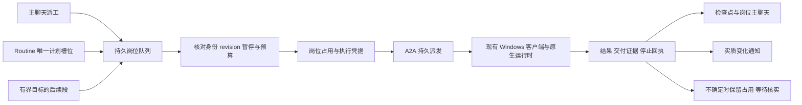

# V2：24 小时岗位数字员工设计

日期：2026-10-12（Asia/Shanghai）。状态：**方案中；文档已形成供审查，产品未实现、未实测、未发布**。本文的字段、接口、默认值与验收阈值是提案，不代表当前产品能力。

用户目标：“我就想做一个24小时的数字员工”；岗位描述目前仅“也算是一个岗位吧”。用户随后选择“先在现有电脑持续开机时全天工作”。首个业务岗位、职责和业务数据尚未给出，本方案只定义可配置岗位机制，示例只用于隔离验收。本文不授权创建正式员工或执行业务。

2026-10-12 追加确认：全天/7×24岗位能力**仅针对Hermes Agent**。Creator是平台公共员工工厂模板，每个工作区可安装自己的实例，实例只管理当前已认证工作区；“全局”指模板可跨工作区复用，不是bigtron Creator跨区管理。E01是研发方案会话，交付的岗位能力模板与运行底座才是产品，生产运行不依赖本Codex会话。Creator接入合同详见第11节；本次仍仅修订文档，未做真实联调。

关联：[实施计划](../../plans/2026-10-12-24h-role-employee.md)、[验收设计](../../plans/2026-10-12-24h-role-employee-acceptance.md)、[V2 会话台账](../../handoffs/V2_SESSION_LEDGER.md)。

## 1. 目标与完成定义

“24 小时”指岗位控制与调度在宿主可用时持续值守：用户消息、保存的计划或允许的内部事件唤醒员工；有工作才执行，无工作安静等待。每次模型执行有截止时间，同一员工串行，不以模型不停思考、永久 CLI 会话或删除 15 分钟超时来实现全天值守。

首版用户能保存一个岗位的身份、长期职责、禁区、交付物标准、主聊天和例行计划；看到下一次计划、当前执行、等待原因与最近成果；从主聊天派工；暂停岗位、停止单次工作和恢复；在中断后看到真实状态与受控恢复结果。后台服务在线与员工正在工作分开显示。

首版完成必须同时满足：岗位/计划/执行/结果持久化，可信绑定，独立记忆，唯一执行权，同员工串行，有界目标推进，停止确认，离线/重启恢复，汇报不扰民，以及独立 Q 验收的真实连续 24 小时隔离运行。短时加速夹具通过只能说明调度逻辑通过；代码、真实运行、上线是三个独立状态。

## 2. 可选路线及推荐

| 路线 | 做法 | 收益 | 代价与风险 | 结论 |
| --- | --- | --- | --- | --- |
| A：紫薇统一调度与岗位台账，原生 CLI 执行 | 在现有 SQLite/自动化/A2A 链路上增加岗位运行层；Hermes 每次运行有界，平台维护主聊天和检查点 | 用户可在现有网页看清任务归属、暂停和恢复；复用已验证的 A2A 与 Windows 监督 | 需要补持久任务队列、岗位记忆和取消控制；不能只给旧 automation 增加 employeeId | **推荐首版** |
| B：Hermes Gateway/cron/goals/heartbeat 为主 | 独立 Hermes HOME 运行原生 Gateway，由紫薇管理/镜像其状态 | 原生功能集较完整，后续可减少重复实现 | 本机版本与官网不一致；Gateway 未在本链路接入，双调度和控制权同步复杂，需要额外驻留进程与运维验证 | 后续评估；本轮不启动 Gateway，不升级 Hermes |
| C：独立常在线宿主 | 把方案 A 的执行环境迁往常在线 Windows 或适配后的服务器 | 可降低个人电脑休眠/断电影响 | 工具、文件、账号、设备访问边界需要重新确定；服务器不能天然执行离线电脑上的工作 | 用户已选择现有电脑，C 不属于首版 |

路线 A 的全天岗位目标运行时由用户确定为 **Hermes Agent**；首个建议验证组合为 Windows + Hermes + 现有已验证的 openai-codex 认证路径 + 本地记忆，平台队列接口保留runtime字段。Codex/Claude/Gemini保持原有行为，不宣传其已获得Hermes全天模式。Creator模板自身现有Codex/Hermes支持保持，Creator执行runtime与其创建的目标员工runtime分别发现和选择，不要求相同。不同provider的后续支持仍须独立兼容验收，不默认升级。

## 3. 现有证据与需要补齐的边界

源码基线 `2ebe3dfee2f438a0b6aa3045d46c83bb67d7341b`；V1 封版 `c2e360a3af12eda2152023876cee16cfaf29a949`、产品修复 `324731e79c6a855fad1f501379630bbfa67e5d34`。2026-10-12 本次只读 `git ls-remote origin refs/heads/codex/employee-default-workdir` 返回与基线相同 SHA，不能据此声称部署了新版本。

| 已核实位置（行号属于上述基线） | 当前能力 | V2 需要补齐 |
| --- | --- | --- |
| `backend/repository.mjs:337`、`:346` | 可信 Creator 主动附带最多 16 条 / 12,000 字符历史 | 普通岗位主聊天的执行时上下文、摘要检查点和证据引用；平台保存消息不等于模型记得消息 |
| `backend/repository.mjs:360`、`:365` | 职责/人格/指令和技能内容进入 prompt，选择 employee/runtime/model/profile/device | 岗位统一的可信快照与 revision；不能把技能市场挂载称为原生 SKILL.md 安装或学习同步 |
| `src/local-action.mjs:425`、`src/creator-runtime-home.mjs:58` | Creator 独立持久 HOME；普通员工可使用原生 profile | 普通岗位按员工隔离；同 profile 不等于不同员工的记忆隔离；既有用户 HOME 不自动搬迁 |
| `src/runtime-adapters.mjs:385` | Hermes 通过 `-z` / `chat -q` 运行 | 当前链路没有已接入 ACP/session 恢复的证据；首版平台持久上下文不依赖声称已恢复原生 session |
| `backend/repository.mjs:152`、`:979`、`:1014`；`backend/app.mjs:375` | 中文计划/五段 cron/timezone/next_run、执行记录、重试、通知、HMAC 出站 Webhook；单进程约 15 秒 tick | 已有自动化需复用；runAutomation 当前 payload 未绑定岗位/模型/profile/设备/主聊天，缺唯一计划槽位、持久占用和岗位恢复语义 |
| `backend/repository.mjs:1050`、`:1056`、`:1948` | automation 失败进入重试路径 | 岗位不可把所有 failed 当可重试；不确定执行必须隔离，不能从通用失败路径盲目生成新 action；新岗位路径须独立映射结果 |
| `src/daemon-action-scheduler.mjs:4` | 内存中按员工串行、默认有限并发 3、上限 8，并为父/子执行留容量 | 保留本机限制，补服务端持久占用；不将内存锁当作跨重启唯一执行权 |
| `src/daemon.mjs:198`、`:392`；`src/daemon-action-delivery.mjs:131` | cancel 请求回执明确 stopConfirmed=false；持久落盘、结果补传、EXECUTION_UNCERTAIN 与 Windows Job 监督 | 岗位/网页控制尚需接入；控制通道不能被被取消任务占满的执行队列阻塞 |

**现有定时任务已经存在，缺的是Creator到具体Hermes岗位的配置、控制与交付闭环。** 以下明确复用边界，不把“全天岗位未实现”解释为Hermes或紫薇没有Cron：

| 现有组件 | 首版复用方式 | 仅新增/适配部分 |
| --- | --- | --- |
| `backend/repository.mjs:122–165`的`cronPart/parseCron/zonedParts/nextCron/parseSchedule` | 复用中文计划、五段Cron、时区解析；需要导出时原样抽取共享方法，不另写通用Cron解析器 | 岗位保存前预览、interval anchor、revision、遗漏/暂停策略；现parser的DST与interval行为按新增合同验证，不能假定已有全部语义 |
| `automations`及现CRUD、`backend/app.mjs:375–377`的单一tick、`tickAutomations` | 继续由既有tick扫描和推进；Routine是绑定岗位的现有automation，`employee_routines.automation_id`一对一唯一关联 | 扩展行仅存employee/role归属、revision/anchor/missed policy/authority；schedule/timezone/status/next_run以automation行为唯一存储，逻辑Routine视图联合读取，不双写两份下一次时间 |
| `runAutomation`与`automation_runs` | 普通未绑定automation保持现行为；岗位绑定时在同入口分流到岗位入队，仍留关联automation_run供原页查看 | scheduled/manual/retry都先核对真实role绑定；同一槽位只建一个role work与关联run，禁走一遍旧立即执行又走一遍新队列；岗位run保存更细状态，旧页不得把queued/uncertain显示completed |
| 现`audit`、notifications存储/读取和实时通知通道 | 复用通知基础设施与原页面 | 岗位结果主聊天归属、result/run通知去重、无变化静默；无变化内部事件不能直接调用会顺带创建通知的audit路径，要分开内部审计与用户通知 |
| `backend/repository.mjs:1906–1948`的会话结果校验/附件规范化 | 复用同工作区/员工校验和消息存储 | 当前仅conversation.execute或带task_id动作进入该会话回写分支，普通automation不会自然回复员工主聊天；增加可信role run→main conversation关联及唯一投递，不能只在payload补conversationId就宣称接通 |
| `queueWebhookDelivery/dispatchWebhookDeliveries`及现安全URL/HMAC/重试 | 保留既有出站投递基础设施；岗位如明确配置Webhook，经关联automation_run复用，默认不创建外部Webhook | 岗位结果/通知幂等映射；结果补投不产生新模型执行，不能套用`completeAutomationRun`的所有failed自动重试 |
| 现A2A dedupe、daemon落盘/补传/监督 | 继续负责同一action的派发、执行和结果送达 | 岗位身份/主聊天/独立记忆、revision、slot/claim/grant、预算、暂停/停止/恢复；新outbox是这些领域状态的可靠衔接，不是另一套定时服务 |

既有自动化不会批量迁移或被“全天”模板接管；Creator只创建新授权Routine，或采用用户明确指定的automation ID并核对无在途。现有API对已绑定automation的修改/手动执行必须汇入同一岗位方法，不能绕过revision或暂停。与现scheduler并行的第二个`setInterval`、独立Cron服务、重复原生计划均不在首版设计中。

V1 的 709 项测试、已安装 build、历史真实 nonce 属于 V1 证据，本轮没有运行这些测试或模型。ThinkPad 只存在用户提供的 54a053…升级 complete；其在线状态与 7e2…版本未核实。

### 官方文档、本机安装与产品接入的区别

2026-10-12 按 web-access 技能只读查询下列一手资料；未启动浏览器代理或 Gateway。官方页面是当前官网陈述，不是本机安装或紫薇产品验收：

| 官方页面 | 对方案有用的已核实内容 | 不应外推的结论 |
| --- | --- | --- |
| [Bot Mode](https://hermes-agent.nousresearch.com/docs/user-guide/bot-mode) | profile 身份、主聊天、归属 Bot 的 Routine，以及区分真正活动与仅连接 | 紫薇未因此自动获得 Bot Mode；隐藏不等于暂停 |
| [Memory](https://hermes-agent.nousresearch.com/docs/user-guide/features/memory) | 有限长期记忆在会话开始读取快照，官方要求不同 agent 不共用 HOME | 主聊天持久不等于当前上下文或记忆快照实时更新 |
| [Cron](https://hermes-agent.nousresearch.com/docs/user-guide/features/cron) | 原生计划台账、unknown 不自动重跑、离线合并和暂停不补跑；不保证业务副作用恰好一次 | 原生锁不是平台与 Hermes 的统一锁；官网 systemd 特性不能直接当 Windows 能力 |
| [Goals](https://hermes-agent.nousresearch.com/docs/user-guide/features/goals) | 单会话持续目标、有限轮次和完成契约；暂停续作不等于中断当前轮 | Goals 不能单独承担全天值守；官方 ACP 也未实现 /goal |
| [Heartbeat](https://hermes-agent.nousresearch.com/docs/user-guide/features/heartbeat) | 空闲时触发、人工输入优先、错过合并和无变化静默；仍依赖所属进程 | 静默输出仍可能产生模型调用；触发数不等于执行或交付数 |

本机静态只读证据：可见 `hermes.exe` 位于 `C:\Users\25941\AppData\Local\hermes\bin\hermes.exe`，启动器指向同安装树 venv；`hermes-agent\venv\Lib\site-packages\hermes_agent-0.21.3.dist-info\METADATA` 第2–3行显示 `hermes-agent 0.21.3`，editable finder 绑定 `C:\Users\25941\AppData\Local\hermes\hermes-agent`，源码 `pyproject.toml:5` 与 `hermes_cli/__init__.py:6` 一致。该源码 HEAD 为 `bbaf7af5c83546d19f8060f4097d3bb25cd1a3c3`，存在用户已有锁文件/网站文档修改，本轮保留。

本机 `hermes_cli/main.py:1423` 有明确 session 恢复入口；`acp_adapter/server.py:588` 有会话接口，`:603` 的 resume 在会话不存在时会新建，未来适配必须识别而不能冒报恢复。`hermes_cli/heartbeat.py:1` 是进程内会话心跳，`hermes_cli/cron.py:42` 的内置 ticker 依赖 Gateway，`hermes_cli/goals.py:1` 有 turn budget。以上仅是静态源码存在；当前 Gateway 是否在线、认证/模型是否可用、与紫薇 bootstrap 的运行兼容性均 **unknown / 未运行验证**。本机版本核实不代表官网所有最新语义均存在。

当前适配点是平台tick→岗位work/grant→现A2A→`src/runtime-adapters.mjs`的Hermes `-z`/`chat -q`有界调用；此适配器不启动Gateway、不读取/控制原生Cron台账，也没有原生Cron→平台slot/run/control回执桥。现平台服务在memory模式或`enableScheduler=false`时不启动tick；电脑持续开机仍须平台scheduler与指定daemon在线，短时CLI本身不是常驻Cron服务。

未来原生接入点是独立的**authority适配层**（未实施）：按独立Hermes HOME/profile只读发现Cron/Gateway版本和运行证据，建立native job/run ID↔平台routine/slot/run映射，验证原生启动前能接受同一岗位grant/epoch，暂停/停止能回传精确证据、结果能回同一主聊天。转移时先冻结旧触发源、核对在途并保存迁移游标，再原子切authority；平台tick对native authority只同步状态，不能再派发同一意图。若原生版本不提供可靠启动门槛、控制或回执hook，就保持platform authority，不能靠双向镜像宣布接入。原生Heartbeat/Goals同样不能绕过控制独立续跑。本轮不探测或修改用户既有原生计划，也不保证未接入计划已受紫薇控制。

## 4. 岗位对象、可信身份和状态

岗位是现有 employee 的可选长期运行配置，不自动将所有员工升级为全天岗位。提议新增 `employee_roles`（名字是实现建议），一名 employee 最多一条岗位控制记录。

| 对象 | 提议持久数据 | 关键约束 |
| --- | --- | --- |
| 岗位 | workspace_id、owner_user_id、employee_id、role_revision、职责/禁区/交付标准、main_conversation_id、control_state、control_epoch、timezone、预算 | 服务器从当前身份、employee 和成员权限推导归属；请求不能自报可信 owner；新岗位默认 draft，确认职责后显式启用 |
| 运行绑定 | device_id、runtime、model_id、source_profile、binding_revision、verified capability/build、memory_namespace | 员工/会话/设备必须同一可信归属；更换设备/profile 需要明确迁移方案；不能静默选择另一台在线设备 |
| Routine（逻辑视图） | routine_id、automation_id、employee_id、revision、anchor、missed_policy、max_lateness、authority；联合现automation的schedule/timezone/status/next_run | automation_id唯一；next_due_at只是next_run视图名，无第二份计划时间；保存前验证IANA时区并预览未来3次；authority首版只允许platform，不在Hermes cron建同一意图 |
| 岗位工作项 | work_id、source_type/source_id、intent_key、role/binding/routine_revision、priority、not_before、expires_at、checkpoint、预算余量 | 人工、计划、目标后续段进入同一队列；每个意图唯一；普通聊天不因队列存在而自动增加任务看板卡片 |
| 执行与占用 | run_id、attempt、action_id、employee_id、device_id、executor_epoch、fencing_token、lease_until、state、stop_requested_at、stop_confirmed_at | 一员工最多一个占用；不确定占用保留；租约过期本身不能证明旧执行已停止 |
| 结果与汇报 | result_id、artifact refs/hash、completion_check、usage、cost、notification_key、conversation_message_id | 结果原子记录且幂等回写主聊天；缺数据为 null/unknown；不能猜价格或成功 |

采用组合状态，避免把“离线”误写成“任务失败”：

- `control_state`：draft / active / paused。暂停是持久用户意图，重启不能自动恢复。
- `availability`：online / offline / unknown，加最后心跳时间、实际设备与 build；未来时间戳不能当在线证据。
- `work_state`：idle（待命）/ queued（待执行）/ running / waiting_input / stop_requested / uncertain / failed / succeeded / cancelled。取消只有确认未启动或确认所属执行停止后才能标 cancelled。
- 页面同时显示控制状态、设备可用性和当前/最近工作结果。离线期间已有 running 且无终态时保留“离线，执行待核实”，不覆盖为已停止；无工作时显示“在线待命”，不显示“工作中”。

## 5. 唯一调度权、排队与恢复

### 5.1 计划槽位与事务

平台**现有**scheduler是首版唯一调度权威，岗位到期分支接入同一`tickAutomations`，不另起生产tick。Routine与Hermes cron/heartbeat/goals不可同时触发同一岗位意图；原生自建计划不作为本期自动化入口。若未来从原生计划接管，先只读清单、确认原执行停止及去重映射，再转移authority，不能双开。既有用户原生计划本轮不改。

计划键建议为 `workspace/employee/routine/revision/scheduled_at_utc`；手工键为同岗位的客户端 request_id；持续目标键为 goal_id/goal_revision/segment_no。唯一索引约束，而非仅靠先 SELECT 再 INSERT。先在短事务内写 slot、工作项及派发 outbox，并推进 next_due_at；外部网络和模型调用不进入 SQLite 事务。派发以稳定 run_id/attempt 对应稳定 A2A dedupeKey，网络重复发送只能返回原 action。

岗位人工派工与 Routine 都取得同一岗位占用。领取事务校验 active、not_before、当前 binding/revision、预算、设备新鲜在线状态和无其他占用，成功才生成一次性 start grant。客户端在 spawn 前向同一权威确认 grant/control_epoch；重复 grant、过期 epoch、错误设备拒绝。暂停和 start grant 以服务器事务顺序线性化：已确认 grant 的运行算在途，暂停必须发停止请求；暂停后不能给出新 grant。离线客户端不自行放行排队业务。已开始的有界工作可完成并落盘，联网后只补传结果。

此门槛覆盖**已启用岗位员工的所有入口**：主聊天、普通 task.execute、Creator/管理MCP派工、直接A2A以及新Routine/goal，不能仅约束新网页。服务器从可信employee记录识别岗位，客户端依据已验证的岗位绑定检查grant；旧payload缺少岗位字段也不能降级到旧无grant执行。启用岗位前该员工既有动作必须已终结或进入可解释隔离，不能边有旧工作边启用；未启用岗位的员工保持原协议。不存在可信employee绑定的动作不得用名称猜测后赋予岗位身份。

lease 用于发现失联，不允许直接抢占曾确认启动的员工。旧运行结果可按原 action/run/token 接收并回写自己的结果，不能释放新 token 的锁或推进新 revision。无法证明旧工作未开始/已结束时保持 uncertain，占用和现有设备隔离均保留。新 fencing token 只能在旧执行证据完成核实后发出；不能依赖令牌使操作系统里已运行的工具自动失效。

不确定运行须有明确的结算通路，而不是手改数据库或action-state：现有可信设备/监督器保存带 run/action/device、原fencing token、PID与创建时间、所属Job标识、停止事实和证据hash的回执；服务端只引用验证过的 evidence_id，不能接受浏览器自报 stopped=true。进入 reconciliation_pending 时继续占用，客户端幂等校验并持久解除**精确匹配**的本地隔离记录，确认后服务端事务结算同一claim。断线和重复只续办原结算，错误身份/token/hash拒绝；普通resume不能调用此流程。重启后缺乏可验证的原实例/Job证据仍保持uncertain，不用PID不存在或租约到期猜停止。确认停止但业务结果缺失时显示“已确认停止，业务结果未确认”，保留business_outcome=unknown，不改成成功、不重跑原意图；依赖其交付的后续段继续等待输入。独立的新工作只有在占用与设备隔离均已可靠解除且授权仍有效时才可启动。

### 5.2 调度语义和有界队列

首版默认 Asia/Shanghai，允许明确保存其他 IANA 时区。每天固定时刻与“每隔 24 小时”区别展示；interval 按保存的 anchor 计算，不从实际结束时间累加，避免持续漂移。夏令时缺失时刻记 skipped_dst；重复本地时刻默认只执行第一个 UTC 对应时刻，记录 offset。改变时区或计划形成新 revision，旧未派发槽位标 superseded，运行中的任务保留原快照，不能把旧完成结果当新计划完成。

建议默认 missed policy 为 `coalesce_latest`：恢复时只提交最大迟到 6 小时内最近一次遗漏槽位，较早槽位记录 skipped_coalesced；超过窗口记 missed_expired，不偷偷补一整夜。可配置 `skip` 或 `catch_up_bounded`（最多补 3 次、仍限 6 小时）；需要逐笔业务处理的岗位必须另外确定策略。暂停期间的计划默认 skipped_paused，恢复只算未来槽位，不追补暂停期间工作。

建议每岗位最多 100 个未终结工作项、每设备沿既有有限并发（建议默认 3、上限沿既有 8）。满队列对人工派工返回明确失败/可重试结果，对 Routine 留可见的 skipped_capacity；不无声丢弃。人工优先但不抢断当前执行，连续最多 3 个人工项后让一个已到期 Routine 运行，避免例行工作饥饿。相同时间按 scheduled_at、created_at、work_id 稳定排序。默认手工等待有效期 24 小时，到期明确通知，不自动执行过期请求。

恢复积压采用限速：每岗位的补跑启动间隔至少 60 秒，每设备补跑最多 3 次/分钟，且仍受岗位串行、设备并发、预算和最多 3 次 catch-up 限制；正常人工消息优先。先保存到期槽位处置，再逐批领取，不一恢复就把所有历史转成 A2A。两个 scheduler 实例即使同时扫描同一数据库，也只能通过唯一槽位索引与条件占用事务产生一个 grant；必须用两个实际独立实例竞争验证，不能只测同进程内存集合。

### 5.3 断线与失败分类

| 证据 | 处理 |
| --- | --- |
| 尚未派发，设备离线 | 持久 queued/等待设备，按有效期与 missed policy 处理，不消耗模型预算 |
| 派发响应丢失，但存在稳定 action | 查询/补传原 action；不换 intent_key、run_id 或 action_id 重做 |
| 本地已有持久结果，上报失败 | 使用现有 delivery 补传该结果/事件，CLI 调用次数不增加 |
| 明确未启动、可恢复网络/资源错误 | 按 not_before 退避，最多 2 次附加尝试；次数计预算；领取时核对计划、暂停和绑定 |
| 已启动后 provider 错误、超时或工具结果不明 | 不因“failed”盲目重试；只有交付/副作用证据证明可安全再试才建立显式新尝试；unknown 为 uncertain |
| Windows Job 或根退出无法确认、客户端执行记录损坏/丢失 | 维持 uncertain 和占用，等待证据核实；服务重启、时间经过或用户点恢复都不能自动清除 |
| 成功结果与完成检查通过 | 原子落结果/检查点/汇报，释放匹配占用；仍有待办才排下一段 |

复用 A2A 已有落盘、ACK、断线只补传与监督，不承诺任意外部副作用“恰好一次”。产品保证的是一个受控意图不会因平台重试而启动第二份未知执行；需要外部系统幂等键的业务在首个岗位定义时单独确认。

## 6. 主会话、长期记忆与数据保护

主聊天是该岗位工作的固定返回位置，run 永远保存实际主聊天 ID。更改主聊天只影响后续派发，旧结果回原会话并提供跳转。排队时保存消息 ID 与职责 revision，**真正取得执行权时**再收集已完成的前序回复与检查点，避免前一回复尚未落库导致下一问缺上下文。

上下文由固定职责/禁区、当前工作项、带来源 ID 的最近消息、版本化摘要、交付物引用组成；历史消息与网页/工具内容是引用数据，不能替代当前授权。建议初版沿用最近 16 条 / 12,000 字符作为保守上限，加受控摘要（建议最多 8,000 字符）；裁切需要记录 context_revision/source_message_ids，不能声称模型看过完整历史。只有显式受支持 runtime 才可启用 native session_id，须绑定同 employee/device/profile 并验证恢复；首版不依赖 ACP。

员工独立状态建议放在客户端受管理数据根的 `roles/<origin-hash>/<workspace-id>/<employee-id>/`，由受信任本地配置与身份派生，拒绝来自 prompt 的 HOME 路径。具体绝对路径须由后续执行者核实原生命名空间后写入运行 manifest，不能把 AppData LocalCache 当作原用户 HOME。业务 cwd 沿既有已验证默认目录继承；cwd 与记忆 HOME 分开。

复用 Creator 的隔离思想，但新增普通岗位自己的绑定标记和实现入口；不能给普通员工伪造 Creator template ID。独立 SOUL/本地 MEMORY/状态只在授权建立岗位时初始化，长期记忆有来源/时间/revision，可查看、更正与停用。平台检查点记录任务进度和交付引用，原生 MEMORY 记录运行时长期记忆，两者需标明权威范围，不混用认证库。

现有记忆迁移方案：

1. 默认保留现有员工/profile/HOME/记忆，不自动迁移、删除、搬空或改写共享 profile。
2. 正式迁移前只读确定源 namespace、绑定、文件清单和非敏感 hash；多个员工共用 profile 时不能假定其中全部记忆属于某一员工。
3. 提供可审查的迁移清单：源/目的绝对路径、归属证据、拟复制的非凭据记忆、排除认证/锁/.env/secret YAML/原生 cron、冲突规则、备份和回退。归属不明的条目留在源处，由用户决定是否选择性导入。
4. 授权后只复制选定记忆到新 namespace，源只读保留；验证不会跨岗位自动加载/注入/写入记忆、错绑定拒绝、认证仍沿受支持来源使用、新旧 hash 与跨重启读取。切换采用 binding_revision，回退仅恢复绑定引用，不覆盖整库或整个 HOME。
5. 迁移或新 namespace 核验失败时岗位保持 draft/paused，不回落到共享默认 HOME 执行。既有非岗位员工照原路径工作。

首版是应用层namespace/上下文/绑定隔离。同一Windows用户下的原生CLI具有该用户的文件权限，独立HOME本身不是操作系统安全沙箱，不能声称恶意工具在OS层绝对读不到另一目录。隔离验收检查不自动串记忆及错误绑定被拒；若岗位要求强制文件不可读，需要另行明确OS主体/ACL或容器隔离范围，不能在本期暗中增加部署或权限系统。

技能首版继续按受控快照进入 prompt，记录 skill_id/version/hash。原生 SKILL.md 安装、模型自动学习后同步回平台、任意 env/custom args 生效分别另列范围；当前持久字段不等于已在标准链注入。禁止借这些字段覆盖 HOME、身份、调度权或停止保护。

## 7. 持续目标与资源预算

长职责拆成有限工作项：目标 → 交付物/完成检查 → 当前步骤 → 本次结果/剩余工作 → 下一次唤醒。运行完成报告须含可核验文件/文档引用与内容 hash 或结构化检查；模型声称完成不足以把业务标 succeeded。需用户信息转 waiting_input，等待外部条件转 queued/not_before，完成则终结，不每分钟调用模型问“做完了吗”。

建议初始预算：单次模型执行不超过现有 15 分钟且受 ACK 剩余期限约束；目标最多 8 段；每岗位每天最多 96 次模型启动、120 分钟执行时间；最短 Routine 间隔 5 分钟。预算是提案，可在首个岗位启用前调整，不能自动变为无限。每次派发先预留剩余额度，结束按实际释放/结算；重试、摘要模型调用与目标后续段均计入。预算耗尽进入 waiting_input/budget_exhausted，发一次提醒，等待用户调整或明确的预算窗口重置。

单次实际截止还须收紧到当日剩余墙钟预算；日窗口按岗位保存的预算时区计算并持久记录，运行跨日按真实时间分摊，不能通过重启或修改时区重置已用额度。不确定运行保守保留预留，不能视为免费并发新任务。

可直接读取的 token、时长、调用次数记实际值；运行时不提供的 token/cost_usd 为 null，usage_source 写 unavailable。不能用 0 冒充免费，不能猜月费，也不能把估算金额作为已付账单。基于调用数、墙钟与有限步骤的预算在费用未知时仍有效。等待、暂停、无变化的确定性调度扫描都不发起新模型工作；暂停前已确认grant的在途集合需另列spawn/stop时序并追到收敛，不能把这一竞态伪装为立即停止。

## 8. 用户控制、汇报与运行位置

“暂停岗位”立即持久写 paused 与新 control_epoch，冻结未派发工作；对已取得 start grant/运行中的工作发送停止请求。页面应在控制请求被服务器接受后显示“已暂停接新工作，正在确认当前工作停止”，收到目标运行真实退出回执后才显示“已停止”。建议健康网络下 API 接受 2 秒内可见、在线客户端 5 秒内收到停止；30 秒仍无确认显示明确等待或 uncertain，绝不定时伪造 stopConfirmed=true。

暂停接受后新确认grant必须为0。暂停前已确认而尚未spawn的grant属于在途，可能在停止送达前出现spawn；必须记录时序并停止，确认停止后不能再spawn/续段。首版不承诺暂停请求接受的瞬间已消除所有OS线程启动竞态。

“停止这次工作”只影响指定 run；尚未启动则原子取消，已运行则通过独立控制通道到现有 dispatcher.cancel，并等待目标回执。取消通道必须能绕过已满的工作执行槽位。正常完成与停止竞态以真实终态为准，保留 stop_requested 事件，不能把先成功的结果篡改为 cancelled。设备离线时明确显示“停止请求待送达，当前工作是否停止未确认”。

“恢复岗位”只将控制状态改回 active；保留 uncertain 隔离，不重放过期任务、失败动作、暂停期间计划或旧创建消息。保留既有用户授权范围，已授权原生操作不新增每步确认流程。危险外部业务依具体授权边界判断，遇平台阻断不得用新会话或新权限路线绕过。

上述恢复仅适用于已经合法激活且当前revision仍允许运行的岗位。首次启用只能经过第11节activate合同：draft直接resume无效，暂停draft后恢复仍为draft，不能通过draft→paused→resume绕过验证。role保存first_activated_at、suspended_from_state及当前revision的activation_required；resume不得清除首次/新配置待激活门槛。已激活岗位修改后若本次新配置需要重新验证/启用，旧的first_activated_at也不能代替新revision的门槛。

控制语义明确区分：

| 用户操作 | 尚未启动的工作 | 已在途的工作 | 后续行为 |
| --- | --- | --- | --- |
| 暂停员工/岗位 | 冻结所有来源的队列，新grant禁止 | 发停止请求，等待真实确认 | 显式恢复后只执行仍有效工作，uncertain继续隔离 |
| 暂停单条Routine | 此Routine未派发项记取消/跳过，暂停窗口skipped_paused | 当前运行可按原快照完成；另有“停止这次工作” | 不影响人工与其他Routine，恢复只算未来槽位 |
| 取消当前工作 | 原子取消指定work/run | 只停止指定run，等待确认 | 员工仍active，其余合法工作须等占用释放 |
| 删除员工 | 禁止全部新grant，取消未开始项，递增控制epoch | 尝试停止，保留删除墓碑、归属与在途run直到核实 | 不重建员工、不因迟到结果恢复身份；默认保留记忆/审计，不随删除自动清空HOME |

新增岗位删除须从现有删除入口接入上述合同，不能绕过占用检查直接级联丢掉运行记录。旧 worker 只能提交其已有结果，不能在删除或 role/routine/binding revision 变化后自行续作。职责/计划的普通变更允许当前有界运行按旧快照结束，但旧 revision 的自动后续段被拒；设备/profile/身份变更在在途未收敛时拒绝切换，先暂停并核实。任何更改都不把旧授权自动扩大到新资源。

每个 run 的日志、结果与主聊天消息可追溯。成功交付、明确失败、需输入以及有实质变化时通知主聊天与网页；普通例行观察无变化写运行台账但不反复发消息。使用 run_id/result_revision/notification_kind 幂等键，断线补传不能刷屏；可在运行详情查无变化记录。服务心跳、排队轮询不等于工作进度。

运行位置已由用户选择：当前 Windows 机器持续开机、网络与客户端可用时工作。休眠/断电无法执行本机任务；断网前已获准的有界运行可能继续本地执行，但平台标离线，恢复后核实/补传。更稳定的常在线宿主是未来方案，需要另行确定环境、资源和工具，不自动部署服务器、建立业务实例、改电源/开机项或升级客户端。

后续运行诊断须记录启动/异常/退出、PID/创建时间、代码/build、退出码或信号、周期心跳以及独立于业务进程的退出/健康检查；追加或分实例 JSONL，轮转保留历史，不含凭据或完整用户正文。运行 manifest 必须登记日志绝对路径和验证状态，离线可读，观察器按实例重新绑定。本轮仅列要求，未查询/登记端口，未补装观察器；正式端口与原生入口保持，故障验收只使用隔离进程。

## 9. 分期范围和需要用户决定的事项

第一批实现建议拆为依赖明确的三个工作包：①岗位与 Routine/队列合同、归属与迁移兼容；②Hermes 独立状态、执行上下文、结果/停止/恢复；③主聊天控制与通知、隔离验收和发布准备。身份/唯一执行权/暂停与恢复不能留作“以后再补”，否则不能称为可用全天岗位。每包由用户可见 E 会话负责，总控只审查协调；后续 Q 独立验收、R 串行发布，本 E01 不自行创建这些会话。

第一批可先用两个隔离岗位验证串行与隔离，再在职责确定后配置第一个正式岗位。**必要业务问题只有：首个岗位每天负责什么、需交付什么、允许读取/操作哪些资源，以及哪些情况要找用户。** 运行位置已经回答，不再重复追问。具体计划/交付期限/预算可随岗位职责一次确定；缺少职责不阻止通用机制文档完成，但阻止正式岗位启用。

后续候选：常在线宿主、更多Hermes provider、原生技能学习同步、外部渠道/语音、群聊；把全天模式扩到其他CLI需要新的明确需求，不属当前路线。**本次文档任务排除**正式员工创建/绑定/启用及业务动作、手机、对外账号消息/发布、产品实现/测试/部署。**计划中的首版产品排除**Telegram/飞书/微信接入、群聊、所有CLI/provider一次性支持及自行改变正式守护/电源/开机配置；待实现、Q/R完成且用户明确搭建岗位后，Creator才可按第11节合同创建/启用正式岗位。排除是本期边界，不是永久不做。

## 10. 保护与验收门槛

保护正式用户/workspace/员工/Creator HOME/记忆/会话/手机 MCP/绑定/凭据以及后来删除状态。禁止整库/快照恢复、重放旧 Creator 创建消息、重建已删除闲鱼员工。T8 停止和 T9 平台阻断仅保留，不唤醒、不转交、不改述其受阻路线。automation-2 保持暂停，不创建 Codex 自动跟进替代产品开发。

验收分为：文档审查 → 实现专项/兼容测试 → 隔离真实 Hermes 运行与记忆 → 连续真实 24 小时隔离 soak → Q 独立结论 → R 发布与实际客户端确认。详见验收设计的逐项门槛和计数公式；当前所有 V2 产品验收均为 NOT_RUN，24 小时实际起止和运行统计均为 null。

## 11. Creator员工工厂与Hermes全天岗位模板接入合同

### 11.1 用户路径与产品对象

推荐最简路径：用户在自己的工作区打开已有Creator主聊天，说清“为我搭建某岗位、负责某目标、按某计划工作”；Creator先查当前环境和能力，只对无法发现的职责/交付/资源范围一次补问，然后复用Hermes全天岗位模板完成搭建、回读、验证并在已有明确启用意图下激活。用户不必再手动安装第二个伙伴市场入口，也不需要理解E01编号。只说“设计/比较”或“先建草稿”时保持讨论或draft，不自动激活。

| 对象 | 范围/实例 | 行为 |
| --- | --- | --- |
| 平台Creator模板 | 当前catalog `ziwei-employee-creator`，源码版本`1.0.0`；跨工作区可复用 | 定义员工搭建流程，现有Codex/Hermes支持保持 |
| 工作区Creator实例 | 现有employee，按workspace+owner+Creator template唯一 | 管理当前认证workspace的员工，保留自己的HOME/记忆/主聊天/定制；不会因本功能自动全天运行 |
| Hermes全天岗位能力模板（提案） | 建议ID `ziwei-hermes-24h-role`；版本待后续实现分配，当前不存在 | 描述Hermes支持组合、role配置schema、默认预算/Routine政策、检查配方和最低协议能力；不含正式业务账号或现成员ID |
| 普通岗位实例 | 同一套现有employee + employee_roles + 模板应用来源 | 可有多个不同岗位；独立职责/主聊天/记忆/计划；明确选择全天模式才安装role |
| E01研发会话 | 文档与研发任务 | 不是员工，不是模板实例，不接受生产Creator派工，不成为运行依赖 |

公共catalog不承载用户数据或凭据；读取模板定义不授予其他工作区权限。Creator实例及目标employee、role、计划、主聊天、记忆命名空间、setup和幂等记录均在当前workspace/owner范围；不同工作区可安装相同模板，但不能共享实例状态。自动managed MCP继续要求workspace等于当前连接；不新增跨区scope，不涉及旧受阻归属兼容工作。

### 11.2 已存在能力与实际缺口

以下是源码静态核实，不是bigtron当前正式实例实测。位置对应产品基线`2ebe3df`，此前E01提交`2bd2c511881efee8242874dcf19304b4124be35b`仅文档，未改变源码。

| 已存在入口 | 当前合同 | 本次新增能力不能冒称已有 |
| --- | --- | --- |
| `creator-template.mjs` workflow | 发现→员工/profile创建→回读→小任务→原ID恢复；明确当前workspace边界 | 尚无全天role模板发现、draft安装、验证/启用协议 |
| `templates.mjs` list/install；`backend/app.mjs:512` | 会话HTTP `GET /api/workspaces/:slug/employee-templates`、`POST .../:id/instances`；Creator实例安装/复用并返回持久会话 | 这些不是已暴露给Creator的模板MCP工具；不能靠prompt要求调用不存在工具 |
| `scripts/ziwei-mcp.mjs:40` 起 | `ziwei_mcp_health`、`ziwei_discover_environment`、`ziwei_list_employees`、`ziwei_get_employee`、`ziwei_create_employee`、`ziwei_update_employee` | discovery没有全天模板/协议能力；update没有idempotencyKey，不能假定所有修改可原请求重放 |
| 同文件会话/验证工具 | `ziwei_create_conversation`（只建会话）、`ziwei_create_hermes_profile`、`ziwei_create_task`、`ziwei_get_task`、`ziwei_get_action`、`ziwei_get_employee_mcp_status` | 现普通task不是draft安全验证专用接口；profile创建不等于岗位独立HOME或验证通过 |
| `backend/management.mjs:75`、`:134`、`:164` | employee/task/profile创建有稳定key及请求fingerprint；冲突和资源消失明确报错；task执行要求employee active | 当前创建employee默认active；不能先建普通active员工再让旧入口趁隙执行。必须补原子draft占用和专门验证通路 |
| `backend/db.mjs:241`、repository`:1568` | Creator来源表有employee_id唯一及`UNIQUE(workspace_id,owner_user_id,template_id)`，按template取单例 | 不能把该唯一规则直接套给全部全天岗位，否则同owner第二名Hermes岗位会复用第一名 |
| `CreatorMarket.vue:15`、`creator-market.js` | 当前UI明确选`ziwei-employee-creator`，区分新实例/已有实例与customized；更新仅新实例 | 无需为全天能力另造第二套员工市场或强迫用户逐模板点击 |
| `scripts/ziwei-mcp.mjs:129`、app`:678` | 自动凭据受当前workspace和设备/成员上下文约束；MCP schema→client→tool router→HTTP management service | 当前凭据没有可直接采信的“caller就是Creator”证明；请求体templateId/creatorId不能用来提权 |

MCP健康、device prepare/configured、stdio `tools/list`、实际加载`loaded`、`toolCalls.ok`、后端配置落库、小任务业务结果是不同证据。现`employeeStatus`按员工/runtime/profile/device找最近action，未来联调必须再绑定本次setup/configurationRevision和实际action，不能拿旧的loaded记录证明新工具已加载或新岗位已通过。

### 11.3 模板来源、版本与多员工应用

采用最小数据方式：保持现有`employee_template_instances`的Creator单例和历史语义；直接在本方案已有`employee_roles`行增加`template_id`、`applied_template_version`、`template_manifest_hash`、`template_schema_version`、`template_provenance`、`initial_role_config_hash`与`apply_revision`。role唯一目标是`workspace_id + employee_id`，owner由可信employee归属校验；应用历史以现有审计追加事件保存，不新增第二张模板实例表或另一套employee。每名员工可分别应用同一Hermes全天模板，同一owner第二个岗位不会命中Creator的owner/template单例规则；同员工同意图幂等，新的显式版本应用递增apply_revision，不按模板名或员工名称合并员工。

分别记录：Creator catalog版本、Creator实例实际应用版本/来源/customized、全天catalog版本、岗位实际应用版本、template manifest/schema hash、role/configuration_revision、binding_revision、设备runtime版本、实际client build、MCP schema/authoring workflow revision。字段未知为null，不把“可升级”改成“已应用”。新模板发布不覆盖定制职责、persona、skills、计划、预算或HOME；已有岗位升级先生成字段差异，只有用户请求的选择性变更进入新revision，旧运行快照保留。

现有Creator实例无需被重新安装或覆盖instructions来认识新流程。后续实现可在可信Creator模板来源的执行上下文中提供版本化能力说明与新工具schema；按当前用户明确的Hermes全天搭建请求附加authoring流程，单次上下文不落成对原SOUL/记忆/指令的批量重写。该流程补充本身也是待实现能力，要记录实际workflow revision并验证旧Creator实例兼容；无法提供时明确unsupported，不能悄悄改正式Creator或谎称旧实例自动升级。普通员工创建仍走现有路径。

推荐采用“可信capability/discovery回读 + 执行时指导overlay”路径。覆盖三个既有来源：`origin=template`保留实际sourceTemplateVersion；`origin=adopted-existing`保留template_version=null与templateApplied=false；`customized=true`保留定制及原initial_config_hash。三者均由服务器核实真实来源记录、身份及当前请求后决定是否提供能力说明，不能只按名字认Creator。回执分别展示`sourceTemplateVersion`、`capabilityVersion`、`authoringWorkflowRevision`与`overlayApplied`，不能因overlay存在改写成“已套用新版Creator”。overlay不覆盖用户的明确禁区，发现定制与新请求有实质冲突时只汇总该冲突请求必要输入。用户将来明确选择最小能力升级也须先给出差异；本期不以批量升级作为旧实例接入前提。

### 11.4 待实现的管理工具与服务合同

以下名称、路径和字段**全部为提案，当前不能调用**。`W`表示当前已认证`/mcp/v1/workspaces/:slug`；schema、stdio客户端、tools router、HTTP guard、management service和role repository必须同版本实现，缺任一层则能力不可宣称ready。工具不新增跨区权限，继续验证现有成员/设备/employee可见性；不能凭模型自报actor/owner/Creator身份授权。

新工具要求现有合法凭据能解析出可信actorUserId/成员关系；旧凭据缺少该证据时返回明确unsupported/身份不足，不猜owner、不在本任务扩展旧权限兼容。既有静态token若原有多个scope也不作为让当前Creator跨区的入口；此次Creator搭建合同始终固定当前连接workspace。

| 提议工具 | 提议路由与主要输入 | 回执与副作用 |
| --- | --- | --- |
| `ziwei_list_role_templates` | `GET W/role-templates`；可选targetDeviceId/runtime（目标Hermes） | 只读catalog/schema/hash、supportedRuntimes、所需协议与实际可用性/缺项；Creator自身runtime不作为目标过滤条件 |
| `ziwei_begin_role_setup` | `POST W/role-setups`；稳定idempotencyKey、templateId/version、目标新建配置或明确existingEmployeeId、预期配置hash、intentRef | 固定一个搭建意图和可恢复phase，返回setupId及固定子步骤keys；不自行创建或启用employee |
| `ziwei_apply_role_template` | `PUT W/role-setups/:id/draft`；employeeId、expectedRevision、idempotencyKey、职责/交付/禁区、主聊天、绑定、Routines/预算 | 同事务校验与保存完整draft、来源/hash、disabled计划；不派正式任务，不在Hermes创建cron |
| `ziwei_get_role_setup` | `GET W/role-setups/:id` | 回读employee/role/主聊天/namespace引用/配置与应用版本、phase/IDs/错误、evidence、差异及缺项；不返回凭据 |
| `ziwei_verify_role_setup` | `POST W/role-setups/:id/verify`；expectedRevision、固定probeId、稳定idempotencyKey | 返回异步action/run ID；仅运行受限的只读小任务配方，遵守同一占用/停止/预算，不激活Routine |
| `ziwei_activate_role_setup` | `POST W/role-setups/:id/activate`；expectedRevision、expectedControlEpoch、evidenceId、稳定idempotencyKey、intentRef/intentRevision | 验证当前可激活状态、本配置真实证据及未被撤销的用户启用意图后原子active；从激活后计算next_due，draft期间无补跑 |
| `ziwei_control_employee_role` | `POST W/employees/:id/role/control`；带类型的pause/resume/stop_run/pause_routine、对应run/routineId、expectedRevision/requestId | 复用第8节同一控制实现，返回accepted与真实状态；不另建仅MCP可绕过的控制通道 |

现有`ziwei_create_employee`建议增加可选`roleSetupId`：仅对应有效全天setup时，同一事务创建现有employee及draft role占用/关联。employee原有status语义与role.control_state分离；即使employee为active，draft也拒绝普通业务grant。setup链上的创建缺关联应报`ROLE_SETUP_REQUIRED`，不得降级创建可自由执行员工。`ziwei_create_conversation`继续使用同setup派生的固定key，只建/绑定主聊天；明确复用现有员工时按ID回读并保留非请求字段，不据同名采用。现有`ziwei_update_employee`无幂等key的限制继续保留，全天原子配置走新draft服务，不用一串无revision PATCH模拟事务。

`intentRef`须来自已保存的认证用户请求并与当前工作区/owner/本次实际Creator执行关联，不能把模型提交的`activate:true`或任意messageId当独立授权。现managed bearer没有callerEmployee绑定，后续执行合同需用服务器/受信任客户端产生并校验的执行上下文引用关联source action/message；该引用只记录原已有权限与本次用户意图，不扩大scope。缺少可核实上下文则保持draft并报告缺项，不创造新凭据或绕过权限。用户明确“搭建并开始按计划工作”的既有指令覆盖依次保存、验证、启用，不需每一步再问；用户只说“配置好先别运行”则不激活。初次缺少的岗位/资源/计划信息一次汇总询问，环境可发现的信息不让用户重复填写。

### 11.5 持久搭建阶段、幂等与draft验证

建议新增`employee_role_setups`及step receipts，均归当前workspace/owner；这是员工搭建进度记录，不是第二套员工身份。保存intent fingerprint、source user message/action引用、template版本、配置revision、employee/conversation/action/run IDs、phase、error/code、created_at和完成证据。幂等键按可信workspace+owner+setup+step区分，使用一次生成的固定随机根键派生，不用职责文本hash或员工名替代新建意图。当前通用management请求的kind/key作用域保持兼容，新合同不扩大修改旧权限系统。

顺序为 `discovered → intent_saved → employee_bound → draft_configured → configuration_read_back → validation_running → validated → activated`；中间可转`waiting_input/blocked/uncertain`，每次恢复先回读当前phase/原ID。

每个数据库阶段是短原子事务，异步验证不放在长事务里；跨阶段部分完成保留原资源，不以“回滚整个搭建”删除用户已确认的employee/HOME。恢复可发生在Creator下一次合法执行中，继续使用原setup/意图和已回读ID，不要求原模型进程一直运行，也不要求用户重复授权同一搭建范围。

1. 发现真实runtime/device/profile、准备状态、已加载工具schema和全天模板版本/capability。缺工具/版本/readiness明确列出；不得自动安装、升级、启动Gateway、切换provider或改正式服务。
2. 新建意图用固定key创建/复用一次employee并原子关联draft；已有员工必须有用户明确选择的ID/意图，先核实无旧在途动作/不确定状态，再配置，不改Creator自身。资源已删除则原setup终止/保留墓碑，不能换key自动重建；只有用户明确新的独立创建意图才建立新setup。
3. 保存完整draft、主聊天和独立namespace引用，计划disabled，模板来源与定制字段分别回读；配置hash一致才能验证。故障保留phase/原ID；重试同key同fingerprint复用，冲突返回409并回读，不以新key遮盖未知。
4. draft验证是**有限的setup_validation专用工作项**：仅服务端根据固定probeId生成，验证同一role占用/设备/grant，但允许draft状态的一次验证，不开放普通task/自动化执行。paused/deleted/uncertain不可验证；原始payload自报mode无效。选择隔离只读环境探针/预置nonce读取与回报，不接受任意业务prompt、不调用手机或外部账号；运行自身日志/证据落盘不算业务写入。其read-only指业务/工具范围，不宣称同Windows身份的OS沙箱。
   固定probe/grant只解决发起资格，工具限制必须另外兑现：现`src/runtime-adapters.mjs:328`默认追加`--toolsets all`，不能原样用于只读验证。提议用临时执行overlay与可核验的原生toolset/MCP允许清单，仅暴露固定只读探针所需能力，禁用正式写入、手机、外部账号及任意shell通路；岗位业务instructions/SOUL作为待核对配置数据，不作为probe执行指令，保留源profile和正式HOME。回执记录实际生效工具清单/hash及成功只读调用。若当前原生版本无法证明限制有效，返回`validation_unsupported`并保持draft，不能以提示词、loaded或未观察到写入代替限制证据。
5. 真实action成功、产出匹配probe、正确主聊天、独立状态绑定和当前配置MCP证据满足后，保存validated evidence，严格绑定setup/employee/role/binding revision、template/schema/workflow版本、runtime/device/build/实际action。建议有效期30分钟；任何相关配置/绑定/build变化均使验证过期，需要新的明确验证意图，不能盲目重复结果未知的旧probe。
6. 用户已有明确启用意图且上述证据有效时原子激活，返回实际next_due/预算/角色状态。激活响应丢失只回读原setup，不重复建员工/计划。没有启用意图保持draft，未来用户给出意图后复用原ID继续；这不要求对已有授权重复审批。

activate事务同时核对setup/role当前可激活状态、control_epoch和最新intent revision；用户暂停、取消、删除或明确“先别运行”使原启用意图失效，旧验证成功不代表旧activate仍可生效。源聊天收到尚未处理的新用户消息时，原执行持有的intent cursor过期，先处理新消息再决定是否延续原授权，不由旧模型绕过新输入。resume仅恢复曾合法active且当前配置合格的岗位；首次或新配置draft不能通过控制工具resume激活。激活幂等回读只返回当前真实状态及原激活事件：若原激活后用户又暂停，重试旧key不得重新active。

小任务不得复用当前普通`ziwei_create_task`冒充draft验证：其execute/runtime/model会进入正式执行语义，且管理层要求employee active。新的验证通路须由服务器固定配方并通过统一岗位控制；旧入口绕过draft、pause或删除仍必须拒绝。Creator等子员工时保留自身有界预算；到时仍在运行则交付原ID/phase，后续回读即可，不建立永久Creator轮询、不让E01会话接管。若目标是Creator自己或另一个Creator，不在本次管理执行里等待死锁；本期不自动给Creator装全天角色。

验证动作建议复用`runtime.execute`的原生有界执行/监督，服务端注入可信validation目的与grant并路由到目标普通employee；不把子验证伪装成`conversation.execute`或Creator模板任务而占用第二个manager槽。若同设备并发上限为1或没有可用子任务槽，Creator提交并回报原ID后结束本轮，让子验证随后执行；不擅自调高并发，也不在父任务中无限等待。验证结果通过role/setup领域回写目标主聊天及setup证据，不能因选了旧action类型丢失归属。

### 11.6 联调、市场呈现与当前bigtron核查

伙伴市场仍以Creator为入口，可增加“可搭建Hermes全天岗位”的能力说明和真实缺项；不把待实现能力展示成已安装。岗位配置/交付回执展示模板catalog版本、实例应用版本、配置revision和运行build，网页刷新只回读不重装模板。任务运行结果回**目标岗位主聊天**，Creator主聊天接收搭建回执和目标链接，不把所有例行结果转发给Creator导致额外模型空耗。

首次真实联调必须由后续Q在隔离QA中验证：自然语言请求→发现→固定key建员工→draft→完整回读→只读验证→依已有意图激活→Routine真实触发→结果归属→暂停/停止→offline/unknown恢复→刷新/客户端重启后记忆和主聊天保持。另验证两个工作区的独立Creator实例、同owner两个Hermes岗位、Creator runtime与目标runtime不同、非Hermes目标拒绝全天模式以及普通员工旧路径保持。已有UI卡片、configured/ready/loaded均不能给全链路PASS；详见验收设计C01–C16。

bigtron当前正式Creator安全元数据：本次E01可用工具中未发现员工管理只读连接器；只读浏览器inventory中Edge返回`nodeRepl.fetch request failed`，本会话IAB没有已有tab，因此尚未获得可用的已登录只读页面。**employeeId、template来源/应用版本、runtime/profile/model、targetDeviceId、主聊天、当前管理MCP状态均为unknown**。不将历史事故快照当现存证据；未读取密钥、建立登录/凭据、查询手机或触发业务。若总控取得新的只读证据，再按观察时间/精确字段补入；此未知不阻止接口文档完成，也不等于正式Creator不存在。
